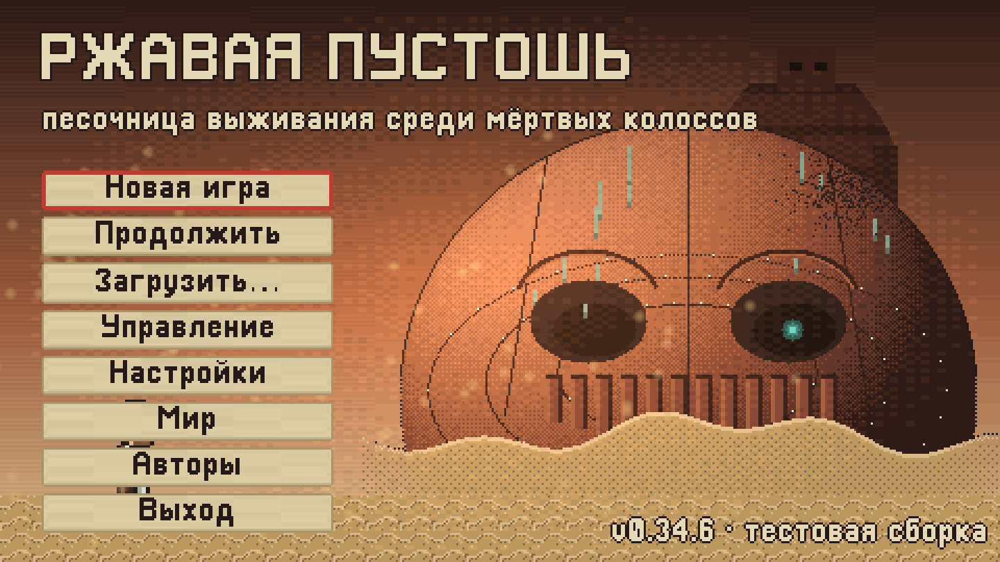
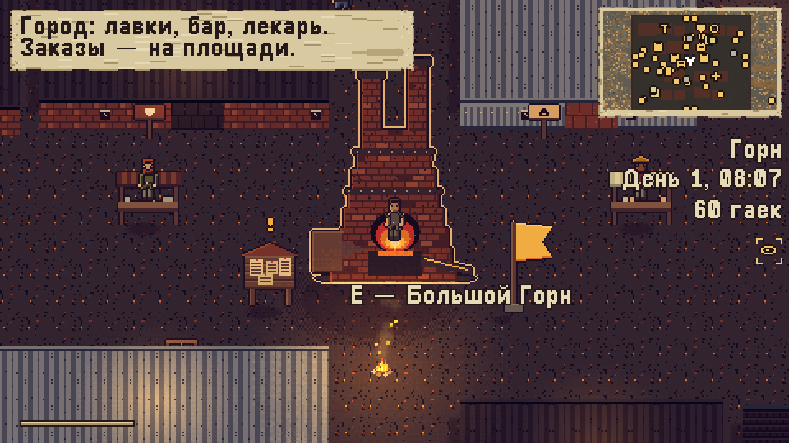
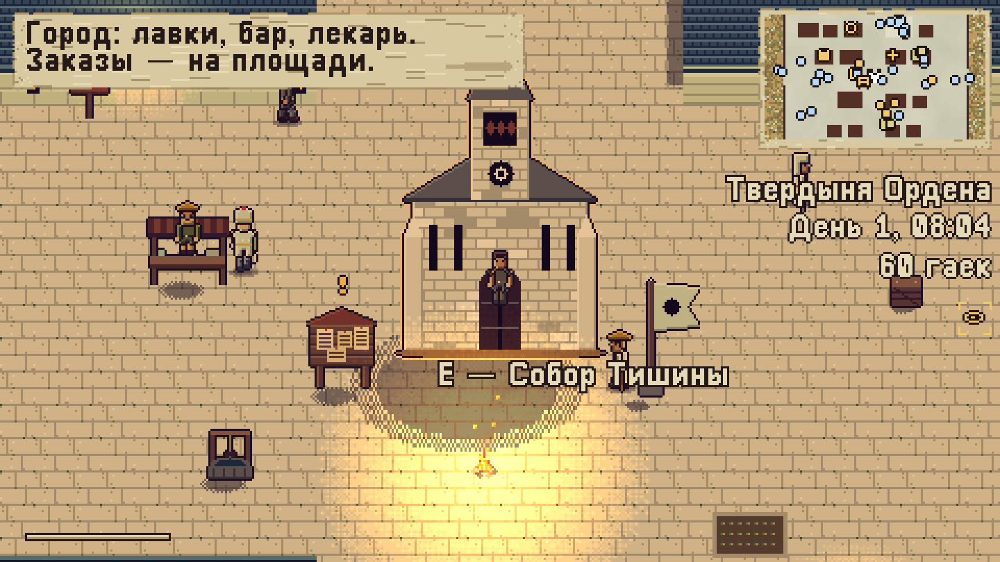
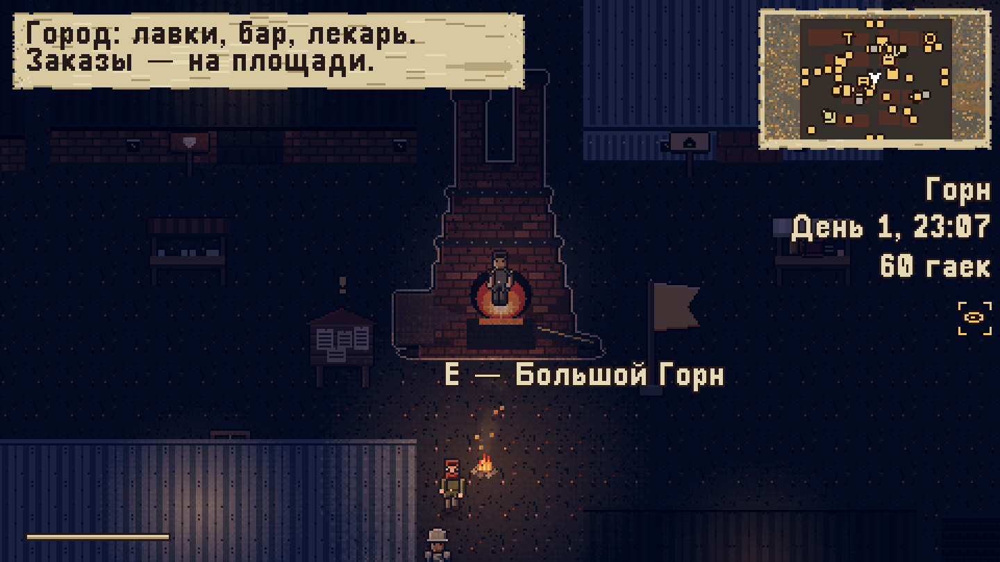
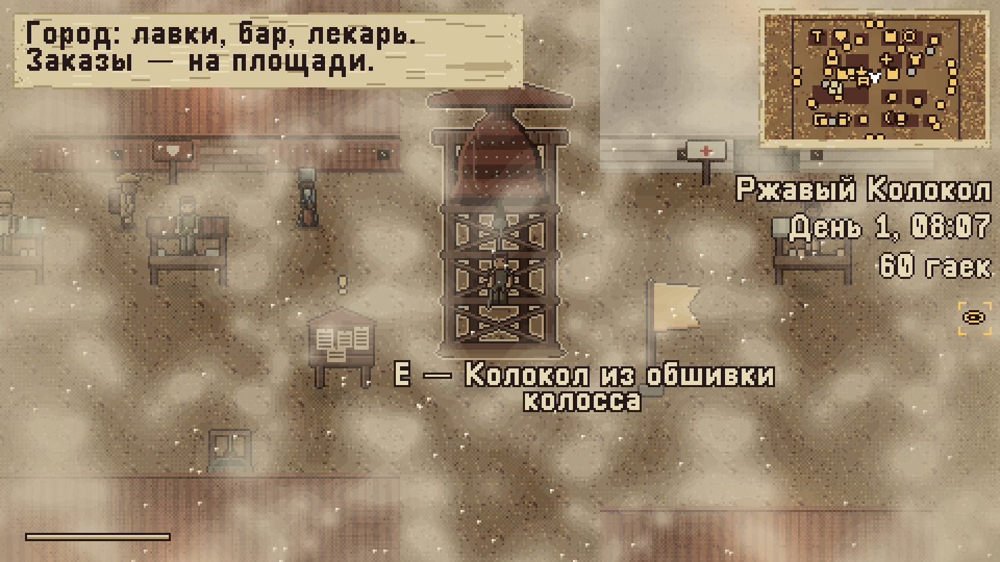
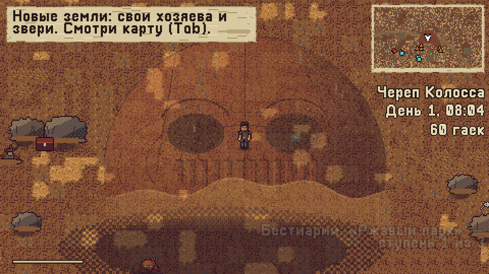
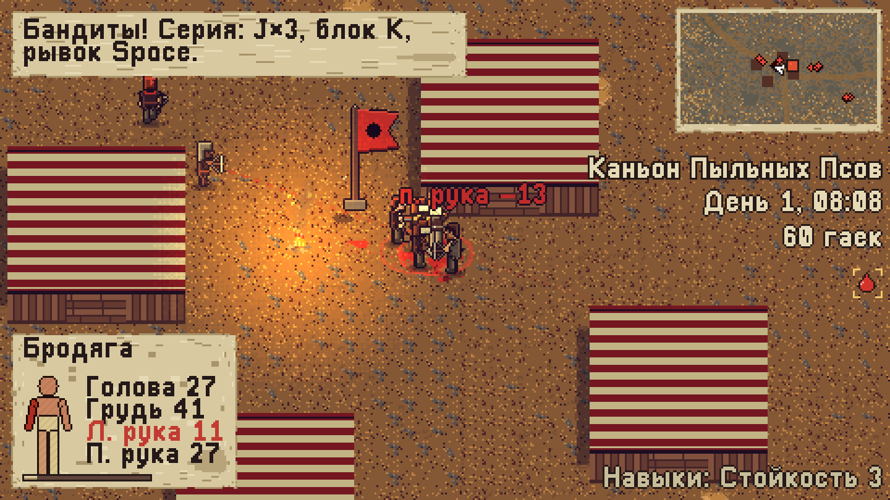
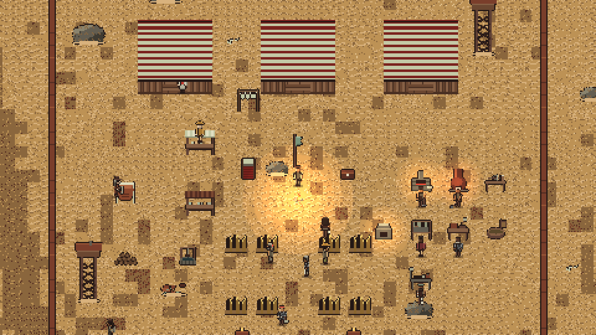
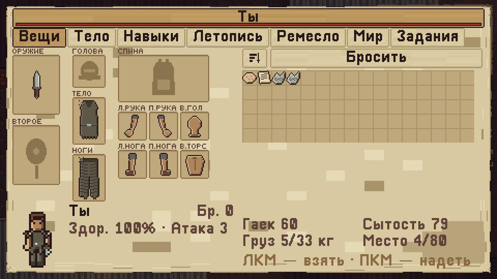
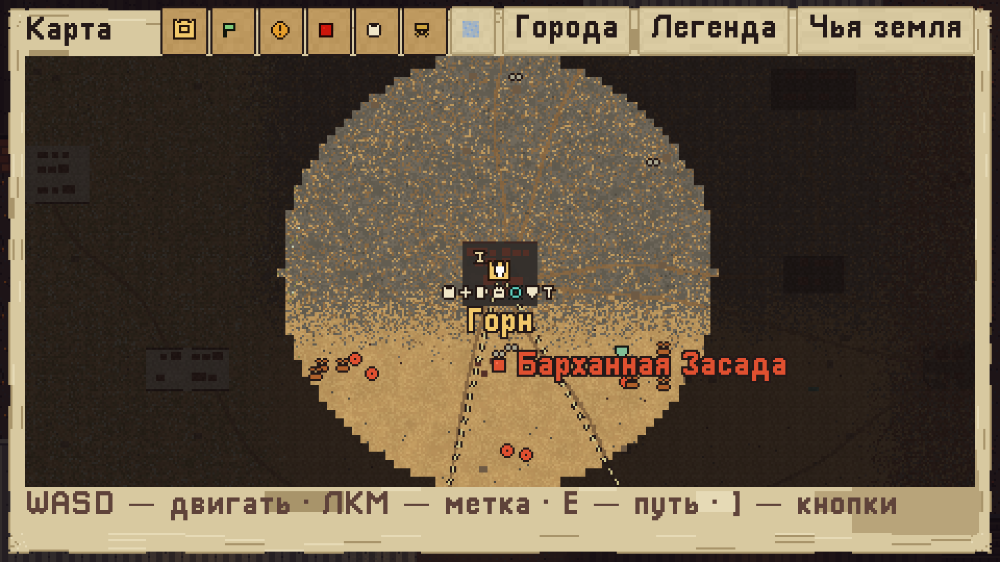

# Ржавая Пустошь

**Песочница-RPG с видом сверху в духе Kenshi: 2D, пиксель-арт, живая Пустошь.** Ты — никто: рваньё и шестьдесят гаек.
Фракции, банды, караваны и города воюют и торгуют без тебя, а кем стать — решаешь сам.

<table>
<tr>
<td width="50%"> Главное меню: Череп Колосса</td>
<td width="50%"> Город Горн: лавки, заказы и большой горн</td>
</tr>
<tr>
<td> Твердыня Ордена и Собор Тишины</td>
<td> Ночь: город засыпает, у костра остаются стражи</td>
</tr>
<tr>
<td> Пыльная буря над Ржавым Колоколом</td>
<td> Череп погибшего Колосса — руины Древних</td>
</tr>
<tr>
<td> Бой в лагере банды: раны по частям тела</td>
<td> Свой лагерь: мастера, склад, ограда</td>
</tr>
<tr>
<td> Вещи: руки, слоты тела, пояс и сумка</td>
<td> Карта: открываешь Пустошь шаг за шагом</td>
</tr>
</table>

## Скачать

Последняя версия — **0.34.8**: [страница релиза](https://github.com/DiehlWierce/rust-wastes-builds/releases/latest).

| Система | Архив |
|---|---|
| Windows 10/11 | [RustWastes-0.34.8-Windows.zip](https://github.com/DiehlWierce/rust-wastes-builds/releases/latest/download/RustWastes-0.34.8-Windows.zip) |
| macOS (Intel и Apple Silicon) | [RustWastes-0.34.8-macOS.zip](https://github.com/DiehlWierce/rust-wastes-builds/releases/latest/download/RustWastes-0.34.8-macOS.zip) |
| Приставки (Anbernic и др., PortMaster) | [RustWastes-0.34.8-PortMaster.zip](https://github.com/DiehlWierce/rust-wastes-builds/releases/latest/download/RustWastes-0.34.8-PortMaster.zip) |

Сборки тестовые и не подписаны. На настоящей приставке сборка PortMaster ещё не проверялась.

## Как запустить

- **Windows:** распакуй и запусти `RustWastes.exe`. Если Windows пишет «Система Windows защитила ваш компьютер» — «Подробнее» → «Выполнить в любом случае».
- **macOS:** распакуй и запусти «Ржавая Пустошь». В первый раз: правый клик → «Открыть» → «Открыть» (macOS 15 — «Системные настройки» → «Конфиденциальность и безопасность» → «Всё равно открыть»). Если пишет, что приложение «повреждено»: `xattr -cr "/путь/к/Ржавая Пустошь.app"`.
- **Приставки:** распакуй `…-PortMaster.zip` в папку `ports` на карте памяти — появится «Rust Wastes». Игра сама включит полный экран, подписи кнопками геймпада и экономный режим. Выход — Select + Start. Если что-то не так, смотри `ports/rustwastes/log.txt`.

Режимы новой игры: «Обучение» (первые шаги по порядку), «Кампания» («Тринадцатый» — расследования ведут к Пастуху), «Свободная игра» (без наставлений). Сохранения прошлых сборок не подходят.

## Что в игре

- **Живой мир.** Банды, караваны, звери и города воюют, торгуют и идут набегом сами по себе, пока ты занят своим.
- **Ты — никто.** Старт без оружия: гайки и рваньё. Кузнец, торговец, наёмник, вождь — путь выбираешь сам.
- **Бой с ранами по частям тела.** Серии ударов, блок и парирование, рывок, арбалеты, протезы вместо потерянных рук и ног.
- **Города со своими фишками.** Горн куёт шедевры на заказ, Соляной Рынок — аукцион, Кряж — лестница чемпионов, Твердыня Ордена — архив Древних.
- **Свой лагерь.** Кузнец, бронник, портной и протезист работают на склад, караваны возят товар по городам.
- **Спутники.** Нанимай людей с именем и историей, учи стойкам (напор, осторожно, охрана) — они дерутся, как ты.
- **Колоссы и подземелья.** Руины Древних с ловушками, дронами и сейфами; пять уровней под Сорокалетним Холмом.
- **Ночь, бури, звери.** Смена дня и ночи, пыльные бури, ездовые звери (H), календарь с рынками и праздниками.
- **Геймпад и приставки.** Всё управляется с геймпада, подсказки кнопок — в каждом окне.

## Что нового в 0.34.8

_приставка: исправление чёрного экрана_

- Приставка: в 0.34.7 игра на RG34XX-SP не запускалась (чёрный экран и вылет при старте) —
  отдельный поток отрисовки и физики убран, игра снова стартует как в 0.34.6. Остальное из
  0.34.7 (пауза, меню, загрузка мира, лёгкий город) осталось.

[История версий](https://github.com/DiehlWierce/rust-wastes-builds/releases) — полный список изменений по каждому релизу.

## Управление

| Действие | Клавиатура и мышь | Геймпад |
|---|---|---|
| Идти | WASD / стрелки | крестовина или стик |
| Удар | J / левая кнопка мыши | X |
| Блок | K / правая кнопка мыши | R1 |
| Рывок | Пробел | B |
| Действие | E | A |
| Вещи | I | Y |
| Персонаж | C | Select |
| Карта | Tab / M | L1 |
| Журнал заданий | L | — |
| Приказ отряду | Q | R2 |
| Сдаться | G | L2 |
| Зверь: сесть, слезть, свистнуть | H | L3 |
| Красться | Ctrl / V | R3 |
| Закрыть окно, меню | Esc | Start (B — назад) |

В окнах с вещами: левая кнопка мыши берёт вещь в руку, правая — быстрое действие (надеть, съесть, купить), Shift — часть стопки. На геймпаде A над вещью открывает меню действий; внизу каждого окна строка подсказок.
